<picture>
  <source media="(prefers-color-scheme: dark)" srcset="./assets/header-dark.svg">
  <source media="(prefers-color-scheme: light)" srcset="./assets/header-light.svg">
  
</picture>

> Complex problems usually have simple, wrong solutions.

I am an MPhil student at The Hong Kong University of Science and Technology (Guangzhou). I completed my bachelor's degree at Macao Polytechnic University. I work on computer graphics, HCI, and digital art, and I am gradually building a public open-source practice.

## Interests

I previously worked on digital humans. I remain interested in sketch editing and layering, and in sketch-based graphics and 3D reconstruction. I write occasional notes on the [personal site](https://fallfield.github.io/).

## Selected public work

- [skills-collection](https://github.com/FALLfield/skills-collection) — agent skills for reference checking, video watching, thesis format checking, and LaTeX-to-Word conversion (MIT).
- [Personal site](https://fallfield.github.io/) — notes on graphics, HCI, and digital art.

## Contact

Feel free to email me, or visit the site for longer notes.

  
  
  
  
  

<!-- Snake SVGs are published to the output branch by .github/workflows/snake.yml. They 404 until the first workflow run. -->

  <picture>
    <source media="(prefers-color-scheme: dark)" srcset="https://raw.githubusercontent.com/FALLfield/FALLfield/output/github-contribution-grid-snake-dark.svg">
    <source media="(prefers-color-scheme: light)" srcset="https://raw.githubusercontent.com/FALLfield/FALLfield/output/github-contribution-grid-snake.svg">
    
  </picture>

